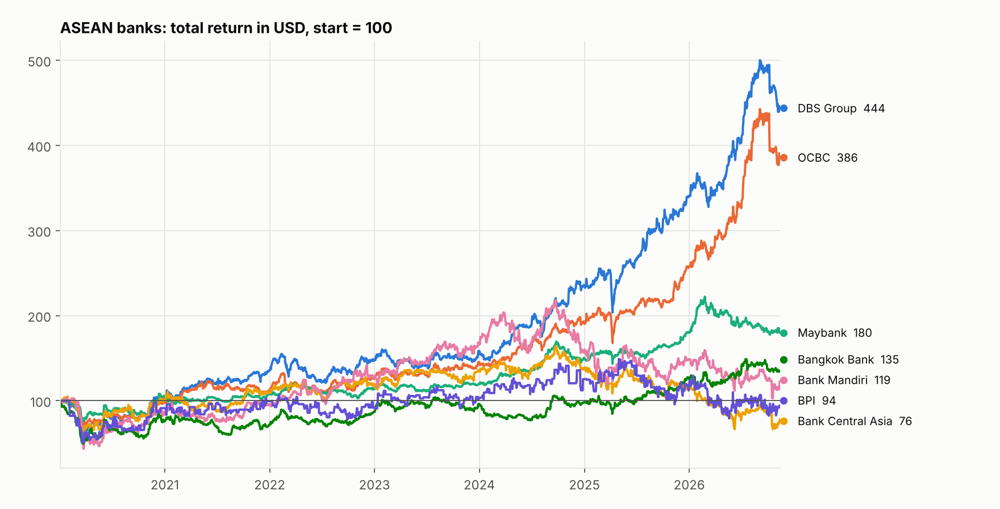
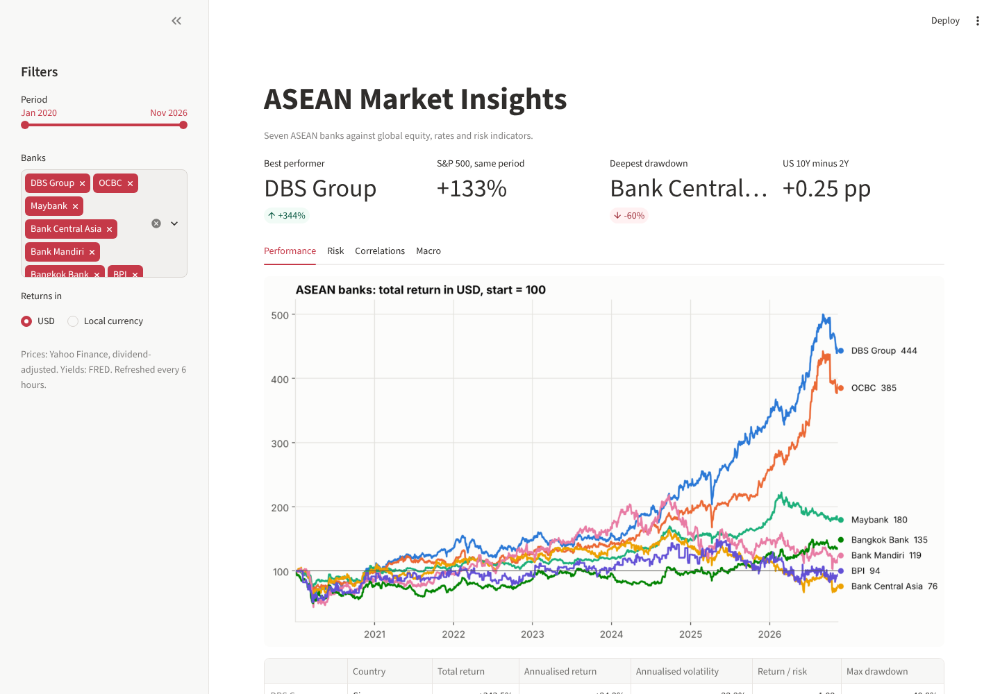

# ASEAN Market Insights

[](https://github.com/Amabelnapitu/ASEAN_Market_Insights/actions/workflows/ci.yml)

How have the largest ASEAN banks performed since 2020, and how much of that is explained by
US equities, US interest rates and global risk appetite?

A Python project that downloads market data, converts everything to US dollars, measures
return, risk and sensitivity for seven banks in five countries, and presents the results as a
written report and an interactive dashboard.



## Findings

Sample: 2 January 2020 to 13 November 2026, weekly returns, in US dollars with dividends
reinvested. Full tables are in [`reports/summary.md`](reports/summary.md).

1. **Singapore's banks are in a different league.** DBS returned +344% and OCBC +286%, against
   +133% for the S&P 500. They did it with similar volatility to the index (20-22% a year), so
   their return per unit of risk (1.1) is well above the S&P's (0.7).
2. **Currency decides the result for Indonesia.** Bank Central Asia's share price is roughly
   flat in rupiah over the period, but the rupiah lost about a quarter of its value against the
   dollar, leaving a USD investor down 24%. Comparing banks in local currency, as most charts
   do, hides this.
3. **The banks move with their home market first.** DBS and OCBC have a correlation of 0.85,
   and the two Indonesian banks 0.72. Across countries the average is only 0.40, so a basket of
   ASEAN banks is more diversified than the shared label suggests.
4. **US rates explain almost nothing week to week.** Once the S&P 500 is controlled for, a
   one-point rise in the US 10-year yield moves no bank by more than 1.5%, and correlations with
   yield changes are all within ±0.10. The banks behave like equities (market beta 0.3 to 0.7),
   not like rate instruments.
5. **They fall less than US stocks in a panic.** In the 10% of weeks with the largest VIX
   spikes, the S&P 500 lost 3.2% on average and the banks between 0.7% (Maybank) and 1.9%.
6. **An inverted US yield curve was not bad news for these banks.** During the July 2022 to
   August 2024 inversion, no bank did worse than in the rest of the sample: DBS returned 24% a
   year in both, Bank Mandiri +34% against -2%. This is a single episode, so it describes what happened rather than what to expect.


<details>
<summary>More charts: correlations, drawdowns, macro backdrop</summary>


</details>

## Interactive dashboard

`streamlit run app.py` opens a dashboard with a period slider, a bank filter and a
USD / local-currency switch. Every table and chart recalculates for the selection.



## Method

| Step | Choice | Why |
|---|---|---|
| Prices | Dividend-adjusted daily closes from Yahoo Finance | Bank returns are largely dividends; price-only returns understate them |
| Currency | Converted to USD with daily FX rates | Puts five currencies on one basis (finding 2) |
| Frequency | Friday-to-Friday weekly returns | Asian and US markets close at different hours, so daily correlations are biased towards zero |
| Sensitivity | Least-squares regression on S&P 500 return and change in US 10-year yield | Separates equity-market risk from rate risk |
| Risk-off weeks | Top 10% of weekly VIX rises | A rule fixed in advance, instead of hand-picked crises |
| Yield curve | US 10-year minus 2-year, from FRED | The standard inversion measure |

Limits: seven large banks are not the whole sector; BPI uses its thinly traded US ADR because
Yahoo has no history for the Manila listing, which inflates its volatility and lowers its
correlations; the sample starts just before the 2020 crash, so results depend on that start
date (the dashboard's period slider shows how much).

## Run it

Python 3.10 or later. No API keys.

```bash
pip install -r requirements.txt
```

Rebuild the report and figures with today's data:

```bash
python -m asean_insights
```

Open the dashboard:

```bash
streamlit run app.py
```

Run the tests:

```bash
pip install -r requirements-dev.txt && pytest
```

## Layout

| Path | Contents |
|---|---|
| `asean_insights/config.py` | Banks, tickers, currencies, factors |
| `asean_insights/data.py` | Yahoo Finance and FRED downloads, USD conversion, local cache |
| `asean_insights/metrics.py` | Returns, volatility, drawdown, regression betas, regime splits |
| `asean_insights/charts.py` | Matplotlib figures |
| `asean_insights/report.py` | Runs the analysis, writes `reports/` |
| `app.py` | Streamlit dashboard |
| `tests/` | Unit tests for the calculations, run by GitHub Actions on every push |

Built with pandas, NumPy, Matplotlib, Streamlit, yfinance, pytest and ruff.

For information only; not investment advice.
