# ASEAN Market Insights

[](https://github.com/Amabelnapitu/ASEAN_Market_Insights/actions/workflows/ci.yml)
[](https://aseanmarketinsights-tmfhnjxwb6mia4mx6ik8fp.streamlit.app/)

How have the largest ASEAN banks performed since 2020, and how much of that is explained by
US equities, US interest rates and global risk appetite?

A Python project that downloads market data, converts everything to US dollars, measures
return, risk and sensitivity for seven banks in five countries, and presents the results as a
written report and an interactive dashboard.


## Findings

Sample: 2 January 2020 to 13 November 2026, weekly returns, in US dollars with dividends
reinvested. Ranges in brackets are 95% intervals. Full tables are in
[`reports/summary.md`](reports/summary.md).

### What happened

1. **Singapore's banks are in a different league.** DBS returned +343% and OCBC +285%, against
   +132% for the S&P 500, with similar volatility (20-22% a year). Their return per unit of risk
   (1.1) is well above the S&P's (0.7).
2. **Currency decided the result for everyone outside Singapore and Malaysia.** Splitting each
   dollar return into share price, dividends and currency shows the currency took 35 points off
   Bank Mandiri, 22 off Bank Central Asia and BPI, and 17 off Bangkok Bank, while adding 19 to
   DBS. Bank Central Asia's share price fell 18% in rupiah, dividends earned that back, and the
   rupiah's fall left a dollar investor down 22%.
3. **Outside Singapore, dividends were most of the return.** Maybank's +80% is +14% from the
   share price and +66 points from reinvested dividends. Bank Mandiri's share price ended where
   it started; all its gain came from dividends.

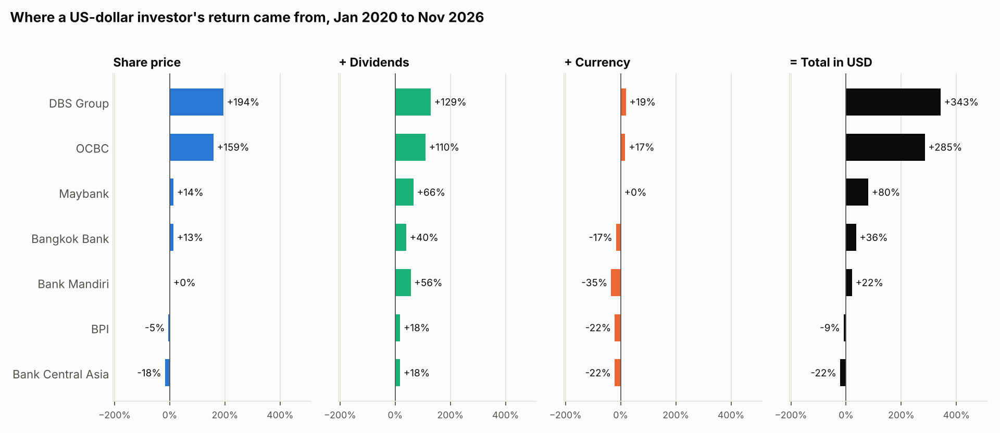

### What drives them

4. **Each bank is driven by its home market, not Wall Street.** The country's stock market
   explains 40-64% of a bank's weekly moves (BPI 14%); the S&P 500 explains 4-22%. Once the
   home market is accounted for, adding the S&P 500 explains at most 2 percentage points more.
5. **Four banks beat their home market by a margin that is not noise.** After stripping out
   home and US market moves, DBS earned +18% a year (+9% to +27%), OCBC +16% (+8% to +24%),
   Bank Mandiri +19% (+5% to +34%) and Maybank +9% (+1% to +17%). For Bank Central Asia, Bangkok
   Bank and BPI the interval includes zero.
6. **US rates explain nothing week to week.** With the S&P 500 held fixed, the effect of a
   one-point rise in the US 10-year yield is within ±2% for every bank, and every interval
   includes zero. The banks behave like equities (market beta 0.3 to 0.7), not rate instruments.
7. **They fall less than US stocks in a panic, but crashes break the model.** In the 10% of
   weeks with the largest VIX spikes, the S&P 500 lost 3.2% on average and the banks between
   0.7% (Maybank) and 1.9%. But in the worst week (20 March 2020) the scenario model predicted
   about -11% for Bank Mandiri and it lost 34%; for BPI -11% against -26%. Singapore's banks
   landed close to the prediction.
8. **The inverted US yield curve made no measurable difference.** Some banks did better during
   the July 2022 to August 2024 inversion (Bank Mandiri +34% a year against -2%), but every
   difference has an interval that includes zero, from DBS (-32% to +32%) to Bank Mandiri
   (-13% to +85%). One episode of two years is too short to tell.

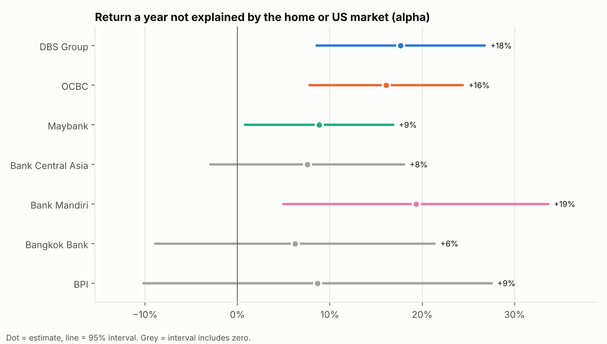

### Where they stand now

9. **The market pays a large premium for Singapore and a large discount for Indonesia's
   second bank.** Banks are valued on price-to-book against return on equity. DBS trades 65%
   above the line that fits the seven banks, OCBC 38% above. Bank Mandiri earns a 22% ROE yet
   trades at 1.2 times book and 5.7 times earnings, 43% below the line, the same discount as
   Bangkok Bank, which earns 6.5%. Snapshot of 15 November 2026; with seven banks the line is a
   rough guide (R squared 0.24).
10. **Bank Central Asia is at the bottom of its range.** It is 52% below its peak in dollars,
    and its last 12 months (-34%) were worse than 97% of one-year windows since 2020. OCBC's
    last year (+62%) beat 93% of them.

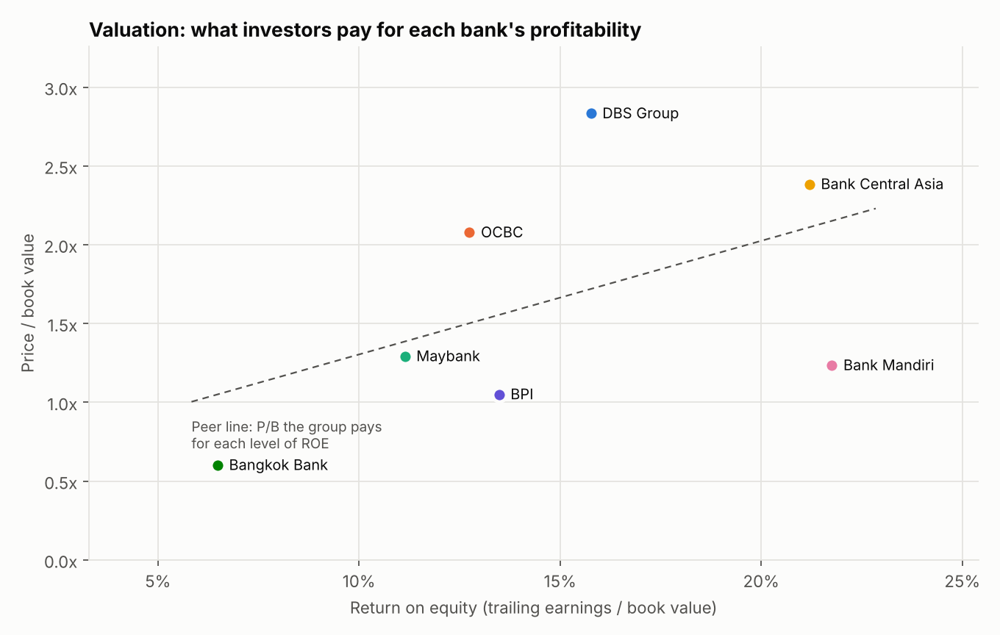

<details>
<summary>More charts: correlations, drawdowns, rate sensitivity, rolling betas, macro backdrop</summary>

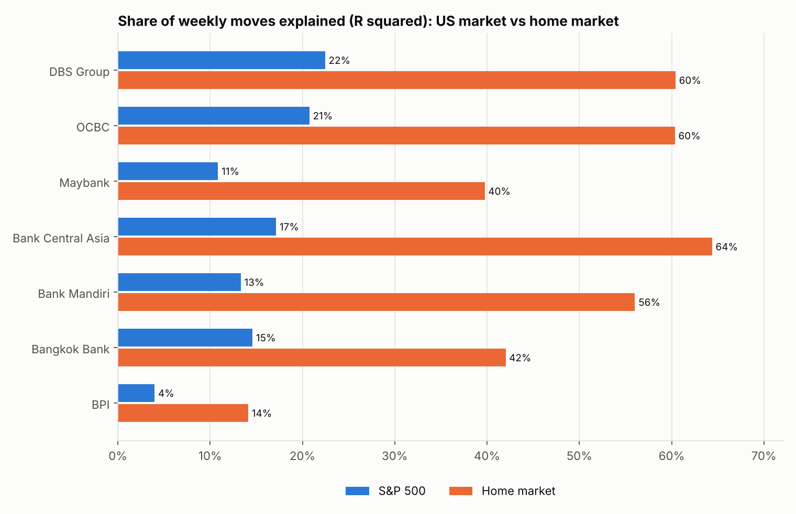
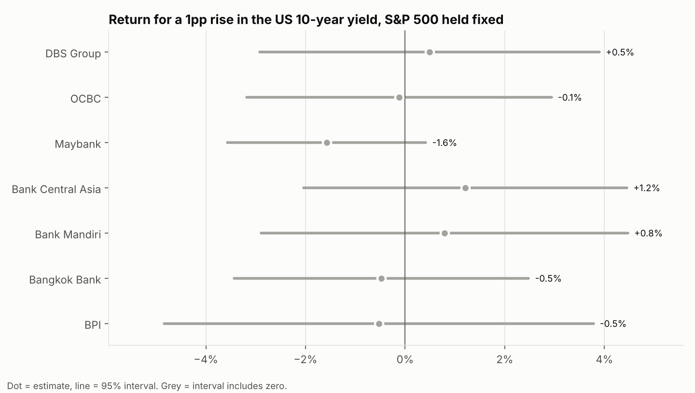
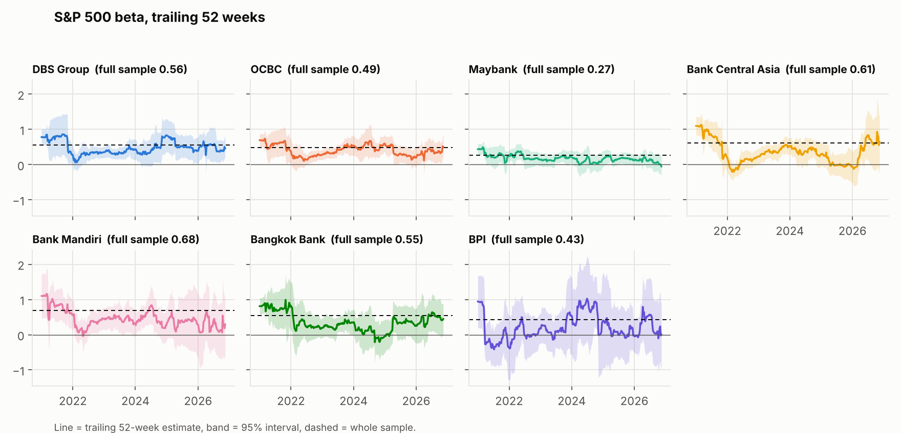
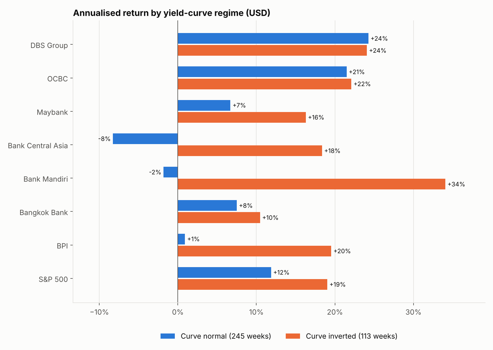
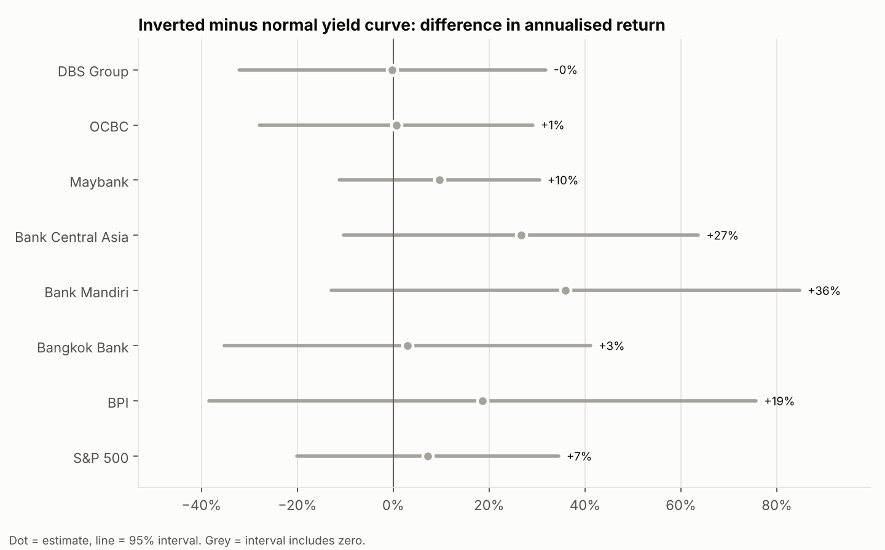
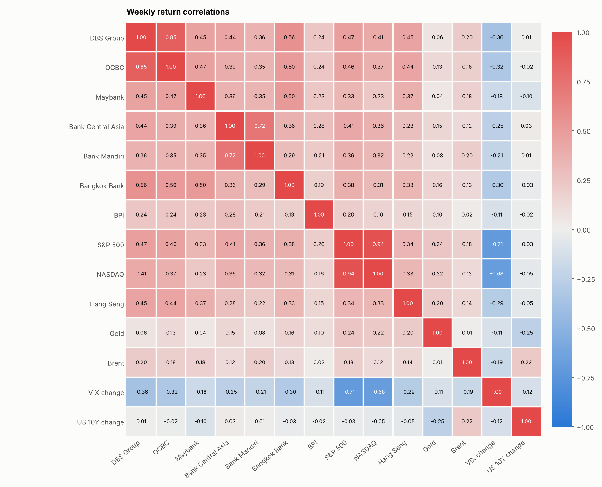
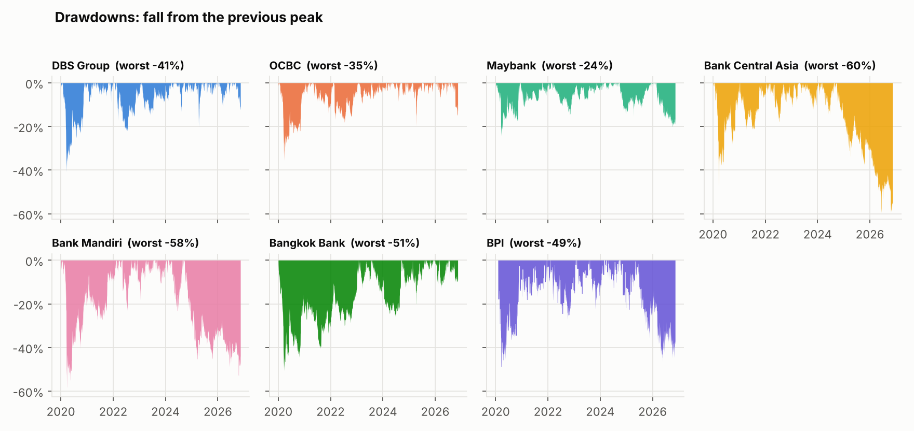
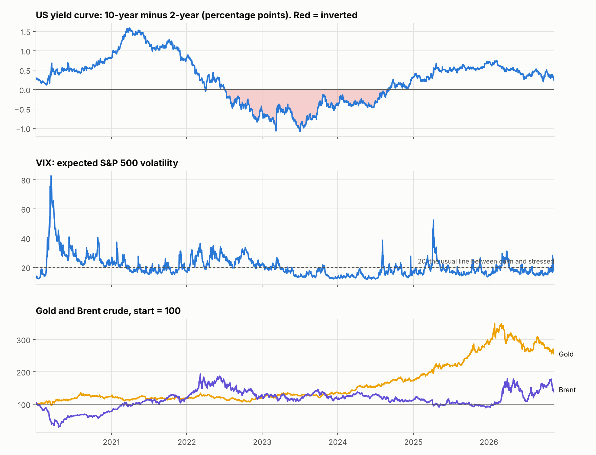

</details>

## Interactive dashboard

**[Open the live dashboard](https://aseanmarketinsights-tmfhnjxwb6mia4mx6ik8fp.streamlit.app/)** (no install needed), or run it locally with
`streamlit run app.py`. It has a period slider, a bank filter and a USD / local-currency
switch, and every table and chart recalculates for the selection.

| Tab | What it answers |
|---|---|
| Now | Where each bank stands against its own history, and whether it looks cheap or expensive for its profitability |
| Performance | Total return, risk, and how much came from price, dividends and currency |
| Risk | Drawdowns, panic weeks, sensitivity to US stocks and rates with 95% intervals, and whether those sensitivities are stable over time |
| Drivers | How much each bank follows its home market versus the S&P 500, and whether it beat both |
| Scenarios | Estimated move for each bank if the S&P 500, Asian currencies or US yields move, with a range; presets replay real weeks and show what actually happened |
| Correlations, Macro | Co-movement between banks, the yield curve, VIX, gold and oil |


## Method

| Step | Choice | Why |
|---|---|---|
| Prices | Daily closes from Yahoo Finance, with and without dividends | Bank returns are largely dividends; price-only returns understate them |
| Currency | Converted to USD with daily FX rates | Puts five currencies on one basis (finding 2) |
| Attribution | Price change, then dividends (total local return minus price), then currency (USD return minus local return) | The three add up exactly to the dollar return |
| Frequency | Friday-to-Friday weekly returns | Asian and US markets close at different hours, so daily correlations are biased towards zero |
| Sensitivity | Least-squares regression on S&P 500 return and change in US 10-year yield | Separates equity-market risk from rate risk |
| Home market | Each country's iShares ETF (EWS, EWM, EIDO, THD, EPHE) | Yahoo has no history for the Thai and Philippine indices; ETFs keep all five on one basis |
| Uncertainty | Newey-West standard errors (4 lags); Welch intervals for regime differences | Weekly return noise varies over time; plain errors overstate precision |
| Valuation | Yahoo's P/B and P/E; ROE as P/B ÷ P/E where not reported; trailing 12-month dividends | Price-to-book against ROE is the standard way banks are compared |
| Scenarios | Regression on S&P 500, home currency and US 10-year change; range adds coefficient and residual uncertainty | Shows a plausible range for one week, not only the average |
| Risk-off weeks | Top 10% of weekly VIX rises | A rule fixed in advance, instead of hand-picked crises |
| Yield curve | US 10-year minus 2-year, from FRED | The standard inversion measure |

Limits: seven large banks are not the whole sector. BPI uses its thinly traded US ADR because
Yahoo has no history for the Manila listing, which inflates its volatility and lowers its
correlations; its peso price is implied from the ADR and the peso rate, and Yahoo's ADR dividend
record misses some payments. Each bank is a large holding of its country ETF, which raises the
home-market R squared. Valuation is today's snapshot only, because Yahoo has no free history of
book value or earnings. The scenario model is a straight line fitted on mostly normal weeks and
understates losses in crashes (finding 7). The sample starts just before the 2020 crash, so
results depend on that start date (the dashboard's period slider shows how much).

## Run it

Python 3.10 or later. No API keys.

```bash
pip install -r requirements.txt
```

Rebuild the report and figures with today's data:

```bash
python -m asean_insights
```

Open the dashboard:

```bash
streamlit run app.py
```

Run the tests:

```bash
pip install -r requirements-dev.txt && pytest
```

## Layout

| Path | Contents |
|---|---|
| `asean_insights/config.py` | Banks, tickers, currencies, factors |
| `asean_insights/data.py` | Yahoo Finance and FRED downloads, USD conversion, local cache |
| `asean_insights/metrics.py` | Returns, volatility, drawdown, regression betas, regime splits |
| `asean_insights/charts.py` | Matplotlib figures |
| `asean_insights/report.py` | Runs the analysis, writes `reports/` |
| `app.py` | Streamlit dashboard |
| `tests/` | Unit tests for the calculations, run by GitHub Actions on every push |

Built with pandas, NumPy, Matplotlib, Streamlit, yfinance, pytest and ruff.

For information only; not investment advice.
